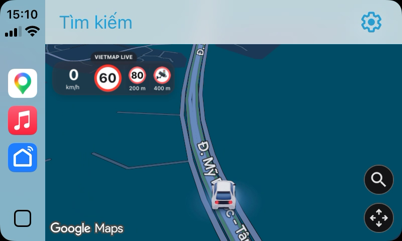
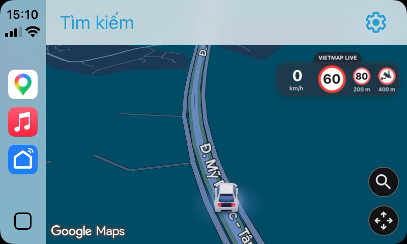
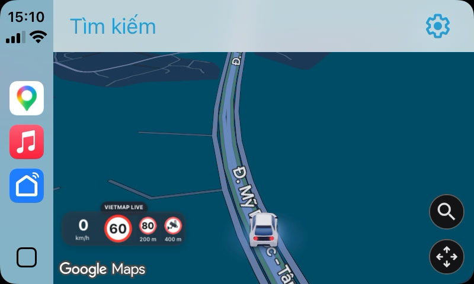
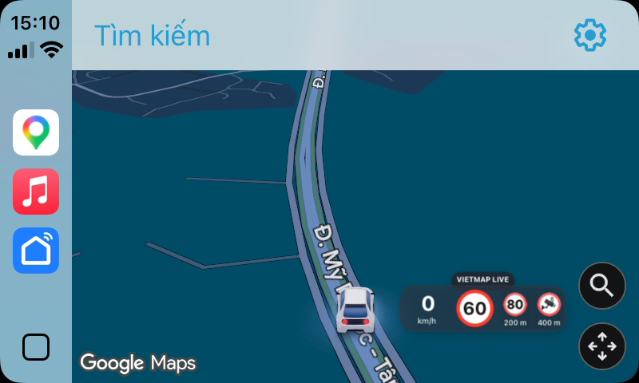
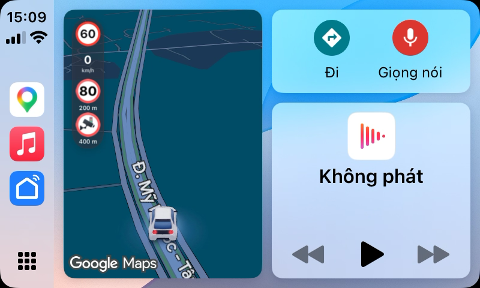
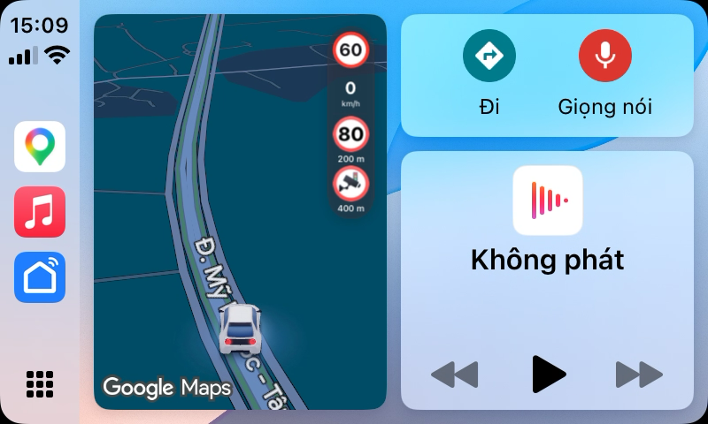

# GMapHUD

**English** · [Tiếng Việt](README.vi.md)

Experimental rootful/rootless iOS tweak that displays fresh **VietMap Live speed and speed-limit data in Google Maps CarPlay**. Inspired by the traffic bubble feature in DuoDash and TrueDash. Google Maps continues to handle navigation.

**Author: chou · AI-assisted with Codex.** chou leads, tests and publishes this independent community project; Codex provided AI development assistance. This credit does not imply that OpenAI is the publisher, copyright holder, maintainer or support provider. Not affiliated with or endorsed by VietMap, Google, Apple or OpenAI.

> Experimental software for stationary testing and research. It is not a certified driving aid. Displayed information may be wrong, unavailable or delayed. Follow actual signs, road conditions and applicable law. Read [DISCLAIMER.md](DISCLAIMER.md) before use; a disclaimer does not guarantee legal protection.

## Bubble placement previews

These are the same CarPlay preview images shown in Settings. They illustrate all supported placements; the displayed values and alerts are examples, not a claim of live-road accuracy.

| Full map · top left | Full map · top right |
| --- | --- |
|  |  |

| Full map · bottom left | Full map · bottom right |
| --- | --- |
|  |  |

| Dashboard · left | Dashboard · right |
| --- | --- |
|  |  |

## Features

Experimental 0.1.14: the horizontal bubble places speed on the left, the limit sign on the right, and a VietMap Live label above. Dashboard uses a vertical bubble with the limit above current speed. Recognized VietMap road alerts use the corresponding VietMap Live artwork and source distance in a shaded VietMap region: up to two side by side on full map, two stacked below speed on Dashboard. Input recognition matches observed image digests from VietMap Live 3.4.3. Bubble size adapts uniformly to the external screen and available map area, including toolbar safe areas; it is capped to preserve map space. Full-map and Dashboard layouts are selected relative to screen width. The preview images above illustrate each supported placement.

In iPhone Settings → GMapHUD, choose any of the four corners for the full map and the left or right edge for Dashboard. The images above show each option. Top-right is the default in both layouts. The alert-source row shows VietMap Live but remains disabled until another source is supported. Placement changes update an open Google Maps CarPlay view; a SpringBoard relay restores saved placement after the phone interface restarts.

- Full-map speed pill and compact vertical Dashboard card; light/dark map colors.
- Current speed remains visible, with `--` when unavailable. Missing limits show a dashed sign.
- Amber from 5 km/h below the limit through the limit; red above it. Visual cues only, no audible alert system.
- Card placement follows the map toolbar's safe area. The Google CarPlay heading/compass control is hidden.
- Speed and limit expire independently after five seconds. A heartbeat does not make old data fresh.
- Optional stationary display test with a TEST badge and automatic expiry.

Published 0.1.13 does not port road alerts. Release 0.1.14 recognizes 46 known alert-image digests from VietMap Live 3.4.3; unknown or changed artwork stays hidden. VietMap's upcoming speed-limit message may omit its image, so supported numeric limits use the matching bundled VietMap Live sign. Camera and upcoming 80 km/h delivery were observed live; other sign categories are mapped from observed app artwork but have not yet been observed in live payloads. Navigation instructions and Live Activities remain unsupported. It includes no GPS spoofing, location replay, DRM bypass or subscription bypass.

## Compatibility

| Component | Verified target |
| --- | --- |
| Device / OS | iPhone 11, iOS 18.6.2, rootless jailbreak |
| Google Maps | 26.40.3 |
| VietMap Live | 3.4.3 |
| Package | `com.chou.googlemaps.vietmap` 0.1.16, arm64/arm64e |

From 0.1.13, Google Maps is not restricted by version or executable UUID. Required private classes and method signatures are still checked; passing these checks does not guarantee compatibility with every release. Package and notification identifiers retain their original namespace for compatibility with existing installations.

From 0.1.13, the VietMap source also has no version restriction. Flutter channel structure and incoming data validation remain enabled. New app versions still require on-device verification.

UI states were checked using a real phone connected to Apple's CarPlay Simulator: normal, near-limit, overspeed and Dashboard. Live stationary values and simulated-location movement were observed. Physical-road accuracy, broad vehicle/head-unit compatibility and reliable background operation across OS/app updates are not established. VietMap display values are interpreted as km/h; simulated playback showed app-side differences from selected playback speed. This is not calibrated instrumentation.

## Install and remove

1. Use a compatible jailbreak and legitimately installed apps with any required VietMap entitlement/subscription. These are not supplied here.
2. Copy **https://bechou0410.github.io/gmaphud/** into **Sileo → Sources → +** or **Zebra → Sources → +**, refresh, then search for **GMapHUD**. The [source page](https://bechou0410.github.io/gmaphud/) has quick-add buttons for both. Alternatively, download the `.deb` from [Releases](https://github.com/bechou0410/gmaphud/releases), and verify its SHA-256 against `SHA256SUMS`.
3. Install through your jailbreak's package manager. Review removal prompts for old bridge/probe packages listed in [tweak/control](tweak/control). This package does not uninstall vendor TrueDash. The source includes rootless (`iphoneos-arm64`) and rootful (`iphoneos-arm`) packages. Rootful 0.1.16 still requires device testing on iOS 14; older app builds may need additional integration changes.
4. Close and reopen VietMap and Google Maps, then open Google Maps in CarPlay. Keep VietMap's background alerts running. A Live Activity alone does not prove fresh speed samples.

No default SSH password is provided or required. A respring is not normally required if both app processes are reopened.

To remove: uninstall `com.chou.googlemaps.vietmap` through the package manager, then close and reopen both apps. Removing files does not unload an injected library from an already-running process.

## Build and test

Requires macOS with Xcode command-line tools, Theos, a rootless-capable toolchain and an iPhoneOS 16.5 SDK obtained under its applicable license. SDKs and dependencies are not bundled.

```sh
git clone https://github.com/bechou0410/gmaphud.git
cd gmaphud
sh test.sh
THEOS="$HOME/theos" sh build-tweak.sh all
```

Packages appear in `packages/`. Both scripts use disposable directories and support spaces in the checkout path. The tested toolchain emits a pre-existing `-multiply_defined is obsolete` linker warning.

## Maintain the Sileo source

Version policy: keep one next version throughout each unpublished development cycle, including every edit, build, and test installation. If the published version is `0.1.13`, all trial builds use `0.1.14`, and the release publishes that same `0.1.14`. Only after publication does the next development cycle use `0.1.15`. Do not increment the version for each trial. Use a commit hash or checksum to distinguish internal builds sharing a version; never overwrite a published package.

The [static source](https://bechou0410.github.io/gmaphud/) is published by GitHub Pages from `main` → `/docs`. [build-repo.py](build-repo.py) owns package/index/site generation, including the bilingual native Sileo depiction, CarPlay screenshot carousel, and changelog tab; [repo-template.html](repo-template.html) owns the shared landing-page layout and [repo-locales.json](repo-locales.json) owns its Vietnamese/English copy. The default page is Vietnamese; [en.html](https://bechou0410.github.io/gmaphud/en.html) is English. GitHub repository Settings → Pages owns this publishing configuration. Check deployment logs in the repository's Actions tab or `gh api repos/bechou0410/gmaphud/pages/builds/latest`.

`docs/CydiaIcon*.png` are the repository icons Sileo fetches from the source root. The `Icon` field in [tweak/control](tweak/control) is the separate package icon; `docs/gmaphud-icon.svg/png` serve the website favicon and branding.

To publish an audited package, run `python3 build-repo.py packages/<rootless>.deb packages/<rootful>.deb` with Python 3 and `dpkg-deb` installed, review the resulting `docs/` changes, then commit and push. The index advertises the supplied version; previous package files remain available for existing downloads. Published filenames are immutable: bump the version before changing package bytes. Only audited production GMapHUD packages belong in this source. Never put logs, keys, app dumps or other local files in `docs/`; the entire directory becomes public.

This is a flat HTTPS APT source (`deb https://bechou0410.github.io/gmaphud/ ./`) with package/index checksums. Release metadata is not PGP-signed; checksums alone do not authenticate the publisher. No global APT trust/security overrides are supplied. To roll back a source publication, revert its commit and push, retaining any already published package files. Confirm that the Pages build succeeded and public indexes match the intended package before announcing an update.

Rollback through a new higher package version if clients have already upgraded; reverting the source index alone does not downgrade installed packages.

## Stationary display test

Run on the phone in a shell with access to the installed tool while Google Maps is open in CarPlay:

```sh
/var/jb/usr/bin/gvm-test-speed 42 50 60
/var/jb/usr/bin/gvm-test-speed 48 50 60
/var/jb/usr/bin/gvm-test-speed 62 50 60
/var/jb/usr/bin/gvm-test-speed 42 60 60 speed_limit_80:200 no_passing_in:400
/var/jb/usr/bin/gvm-test-speed off
```

Arguments: current speed (0–400 km/h), limit (1–400 km/h), duration (1–300 seconds), and optionally two VietMap asset names with distances (0–10000 m each), as `SIGN:METERS`, for trial 0.1.14. Bare distance numbers remain accepted as camera signs. Only the Google CarPlay display model changes; GPS, navigation and real VietMap data remain unchanged. By default, TEST remains visible until `off` or expiry. Missing live values remain missing after testing.

## Diagnostics · 0.1.15

After installing, close and reopen both Google Maps and VietMap Live. Reproduce the issue, then open **Settings → GMapHUD → Chẩn đoán / Xuất log**. Tap **Làm mới** (Refresh), then **Sao chép báo cáo** (Copy report) or **Xuất file…** (Export file) to share a `.txt` report. Review the visible report first; nothing is uploaded automatically.

The report includes hardware model (no serial number), OS, app versions observed by the modules, hook/channel status, sample freshness and CarPlay rendering checkpoints. It retains up to 16 recent checkpoints per app plus the last checkpoint for each stage. It excludes coordinates, routes, accounts and arbitrary app log text. This is bounded diagnostic telemetry, not a full system log. Notification state may disappear when processes or the notification service restart; collect it while reproducing the issue. App versions may be unavailable if a module never loaded. Add the jailbreak version and split-screen tweak name manually when requesting support.

0.1.15 has passed host tests, built for arm64/arm64e, and installed on iPhone 11. Clipboard/sharing and cross-app diagnostic transport still need device validation; this release adds diagnostics, not a confirmed fix for missing data on iOS 16.

## Architecture and privacy

`provider/vietmap-source.x` observes the existing VietMap Flutter overlay channel and forwards its original handler/reply unchanged. Validated speed and limit, each with their own monotonic receive time, travel through local Darwin notification state. Road alerts are decoded from JSON-string items in `vml_main_channel/updateUpcommingAlerts` and `updateStickyAlerts`, matched against exact 3.4.3 asset digests, and relayed as up to two provider-coded kind/distance states. Empty lists clear their source; original timestamps expire after five seconds. Release 0.1.14 bundles the 46 VietMap sign images for display; notifications remain numeric only. Those third-party images are excluded from the project MIT license. Google hooks apply them only to external CarPlay map windows; phone views retain original calls.

The tweak creates no network listener, telemetry upload, publisher daemon or saved credentials. App-sandbox `tmp/googlemaps-vietmap-source.log` and `tmp/googlemaps-vietmap.log` record numeric speed/limit availability and hook status, not coordinates or routes. Local notification state is not cryptographically authenticated and can be affected by other privileged/injected software. Review device logs before sharing.

## License

Project-authored code is offered under [MIT](LICENSE). The package also contains selected VietMap Live artwork for display; these images are third-party material, are not covered by MIT, and remain subject to their rights holders' terms. The project does not claim ownership or grant permission to redistribute them. Third-party apps, maps, traffic/sign data, trademarks, SDKs and dependencies retain their owners' rights and terms. See [DISCLAIMER.md](DISCLAIMER.md) for lawful-use, safety, compatibility and warranty notices. Licensing does not certify legality, accuracy or roadworthiness.

For unedited Settings screenshots, append `--photo` to hide the badge for that bounded sample only. `gvm-test-speed position top-left left` changes Full Map/Dashboard placement temporarily without writing user preferences; restore the previous placement after capture.
